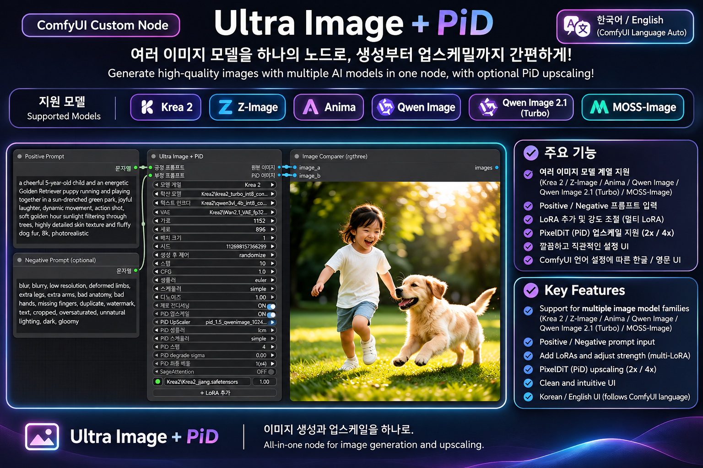

# Ultra Image + PiD — ComfyUI 이미지 생성·업스케일 / Image Generation & Upscaling

**Krea 2 · Z-Image · Anima · Qwen Image · Qwen Image 2.1 (Turbo 포함) · MOSS-Image**를 하나의 독립 ComfyUI 노드에서 선택해 생성하고, 지원 모델에서는 **PiD(PixelDiT) 업스케일**을 선택적으로 실행합니다. **기존 Ultra Tools 패키지는 설치할 필요가 없습니다.**

**Generate images using six model families in one standalone ComfyUI node**, with optional PixelDiT (PiD) upscale on supported families. The separate Ultra Tools bundle is **not required**.

**언어 자동 전환 / Automatic Korean–English UI:** 노드의 메뉴·설정 표시 언어는 **ComfyUI 언어 설정에 따라 자동으로 한국어 또는 영어로 전환**됩니다. 별도 언어 전환 스위치는 필요하지 않습니다. / **The node's menus and setting labels automatically follow the ComfyUI language setting (Korean or English).** No separate language switch is needed.



*노드 인터페이스, 주요 기능과 생성 결과 예시 / Overview of the node interface, key features and an example generated image. UI labels automatically follow the ComfyUI language setting (한국어 / English).*

### 어떤 노드인가요? / What does this node do?

프롬프트와 모델을 선택해 이미지를 생성하고, 필요하면 **같은 노드에서 PiD 업스케일**을 실행할 수 있습니다. 모델 계열별 생성 처리, 여러 LoRA, 원본/PiD 이미지 출력을 한곳에 모았습니다.

Choose a model family, enter your prompts, and generate images. Where supported, enable **PixelDiT (PiD) upscaling in the same node**. Model-specific generation, multiple LoRAs, and separate original/upscaled image outputs are integrated into a single ComfyUI workflow.


> **v1.0.0 첫 공개 / First public release.** 이 패키지는 이전 `comfyui-Ultra-Tools`의 `UltraImagePiD`와 별도 등록 ID인 `UltraStandaloneImagePiD`를 사용합니다. **기존 워크플로우가 자동으로 변환되지는 않습니다.** / This standalone package uses node ID `UltraStandaloneImagePiD`, which differs from the legacy `UltraImagePiD` in `comfyui-Ultra-Tools`. **Existing legacy workflows are not automatically migrated.**

## 설치 / Installation

**Git 설치 / Git installation**

```bash
cd ComfyUI/custom_nodes
git clone https://github.com/Yamoon-jjang/comfyui-Ultra-Image-PiD.git
```

**수동 ZIP / Manual ZIP:** GitHub [Releases](https://github.com/Yamoon-jjang/comfyui-Ultra-Image-PiD/releases)에서 ZIP을 받아 `ComfyUI/custom_nodes/comfyui-Ultra-Image-PiD/`로 설치합니다. `__init__.py`가 그 폴더 바로 아래에 있어야 합니다. / Download the ZIP from Releases, extract it to that folder, and ensure `__init__.py` is directly inside it.

**ComfyUI Manager:** [Comfy Registry](https://registry.comfy.org/)에 게시된 버전이라도 **Active 심사 완료 전에는 Manager에서 정상 설치되지 않을 수 있습니다.** 이 경우 Git 또는 ZIP으로 설치할 수 있습니다. / Registry publication does not guarantee an installable Active status in Manager; use Git or ZIP until approved.

설치 후 ComfyUI를 재시작하고 브라우저를 필요하면 `Ctrl+F5`로 새로고침하세요. 노드 검색에서 **Ultra Image + PiD**를 선택하거나 `예제/Ultra_Image_PiD_Standalone.json`을 엽니다. / Restart ComfyUI, hard-refresh your browser with `Ctrl+F5` if needed, then search for **Ultra Image + PiD** or load `예제/Ultra_Image_PiD_Standalone.json`.

## 기능 / Features

- **여섯 모델 계열 / Six model families:** Krea 2, Z-Image, Anima, Qwen Image, Qwen Image 2.1 (including Turbo), MOSS-Image. 모델별 생성 방법은 내부에서 자동 처리합니다. / Model-specific generation flow is handled internally.
- **PiD ON/OFF:** 지원 계열에서 4× PixelDiT 업스케일 후 4× 또는 2× 출력 선택 가능. OFF일 때 `PiD Image`는 원본 이미지를 전달합니다. / Optional PixelDiT upscale, with original passthrough when disabled.
- **동적 LoRA / Dynamic LoRA:** 여러 LoRA를 추가하고 순서·활성화·강도를 관리합니다. / Stack LoRAs in user-defined order.
- **Negative & Zero Conditioning:** 외부 STRING negative 입력 및 조건 방식 선택. / Optional external negative STRING and zero-conditioning option.
- **설정 자동 기억 / Per-family settings memory:** 모델 계열별로 **최초 생성 요청이 큐에 정상 등록된 뒤** 마지막 사용 설정을 기억합니다. 프롬프트와 Seed는 기억하지 않습니다. / Settings are saved after a successful queue submission; prompts and Seed are not stored in this per-family memory.
- **한국어·영어 자동 전환 / Automatic KO–EN UI:** ComfyUI에서 설정한 언어를 따라 메뉴가 자동으로 표시됩니다. / Node labels automatically follow your ComfyUI language preference. No manual toggle is needed.
- **SageAttention (선택 / optional):** 호환 가능한 [ComfyUI-KJNodes](https://github.com/kijai/ComfyUI-KJNodes)가 필요합니다. / Requires a compatible ComfyUI-KJNodes installation.

## PiD 모델 설치 / Download PiD Models

모델 파일은 패키지에 들어 있지 않습니다. **모델 계열에 맞는 PiD 확산 모델만 직접 선택**하면 PiD 컨디셔닝, context window, 기타 내부 경로는 노드가 처리합니다. 모델 자체의 호환성과 VRAM은 사용자가 확인해야 합니다.

**English:** Model weights are not bundled. Select the compatible PiD diffusion model for the chosen image model family; the node handles PiD conditioning, context windows, and other internal routing. You must still verify model compatibility and sufficient VRAM for your setup.

| 이미지 생성 모델 / Generation model | PiD 확산 모델 / PiD family | 지원 / Status |
|---|---|---|
| Krea 2 / Anima / Qwen Image | `qwenimage` PiD | 지원 / Supported |
| Z-Image | `flux1` PiD | 지원 / Supported |
| MOSS-Image | `flux2` PiD | 지원 / Supported |
| Qwen Image 2.1 (Turbo 포함) | 별도 호환 PiD 없음 / No compatible PiD in this node | OFF (잠금 / locked) |

- **PiD diffusion 모델:** [Comfy-Org/PixelDiT — diffusion_models](https://huggingface.co/Comfy-Org/PixelDiT/tree/main/diffusion_models) → `ComfyUI/models/diffusion_models/`
- **PiD 전용 Gemma ELM text encoder:** [Comfy-Org/PixelDiT — text_encoders](https://huggingface.co/Comfy-Org/PixelDiT/tree/main/text_encoders) → `ComfyUI/models/text_encoders/`. `gemma_2_2b_it_elm_fp8_scaled.safetensors` **또는** `gemma_2_2b_it_elm_bf16.safetensors` 중 하나가 필요합니다.
- `pixel_space`는 ComfyUI 코어에 제공되는 가상 VAE 이름이므로 **별도 pixel_space 파일을 다운로드하지 않습니다.** 일반 이미지 생성에는 해당 모델에 맞는 VAE가 필요합니다. / `pixel_space` is a virtual VAE name provided by ComfyUI core, **not a separate file to download**. Regular image generation still requires the appropriate model-family VAE.
- 초기 PiD 설정은 sampler `lcm`, steps `4`를 참고하세요. Scheduler 기본값은 설치된 코어에서 사용할 수 있는 `sgm_uniform`(또는 fallback `simple`)이며, 자세한 조건은 통합 설명서를 따릅니다. / For initial PiD settings, start with sampler `lcm` and `4` steps. The scheduler defaults to `sgm_uniform` when available in your ComfyUI core, with `simple` as fallback. Refer to the manual for details.

## 설명서 / Manual

**[한국어·영어 통합 manual.txt](manual.txt)**에는 모델 준비, PiD 모델 파일 선택, 설치 위치, LoRA/Negative/Zero Conditioning, 설정 기억, 문제 해결을 상세히 설명합니다. / The bilingual `manual.txt` covers installation, model mapping, settings memory, and troubleshooting.

## 호환성 및 검증 / Compatibility & Validation

최신 ComfyUI의 각 모델별 코어 노드가 필요합니다. 패키지에는 별도 학습 모델·PiD 가중치가 포함되지 않습니다. 기능 변경을 하지 않은 안정판에 대해 Python/JavaScript 구문·정적 패키지 검사를 수행했으며, **모든 GPU 및 ComfyUI 설치 환경에서의 동작을 보장하는 것은 아닙니다.** / Requires the model-specific nodes available in a compatible recent ComfyUI core. Generation model weights and PiD weights are not bundled. Python/JavaScript syntax and package checks do not guarantee successful operation across all GPU and ComfyUI environments.

**소스 라이선스 / Source license:** GPL-3.0 ([LICENSE](LICENSE)). 외부 모델은 각 모델의 라이선스를 따릅니다.
